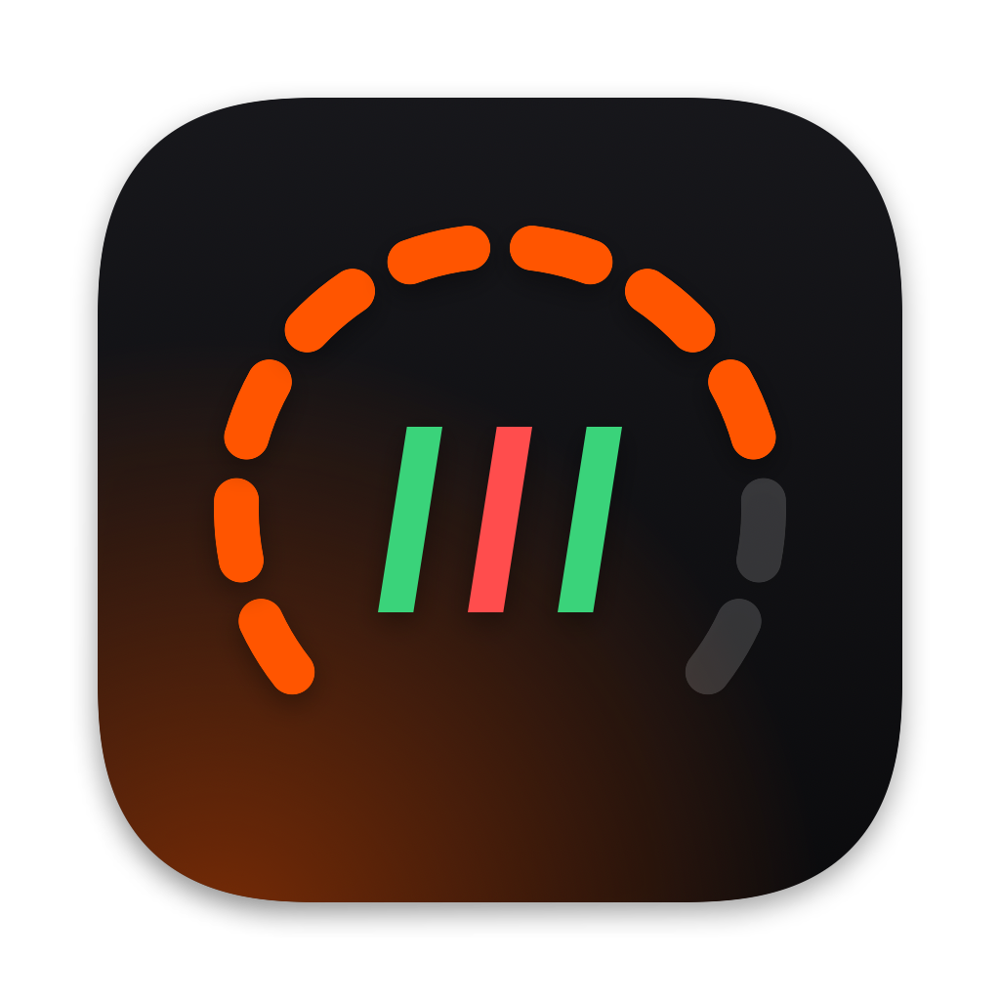
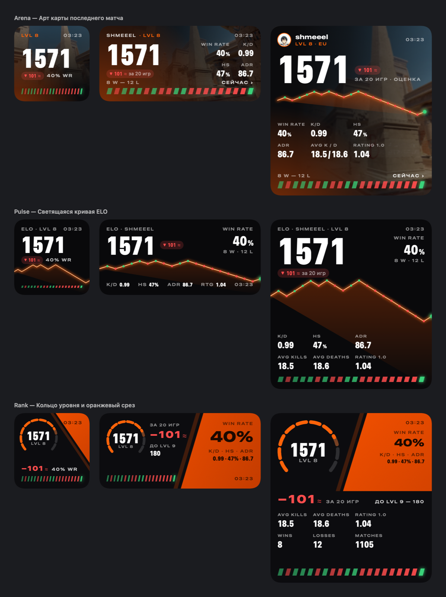

<p align="center"></p>

# SimpleFaceitWidget

**[Русская версия ниже](#русский)**

Native FACEIT CS2 stats widgets for the macOS desktop and the iPhone home screen: current ELO, ELO change over the last 20 matches, win rate, K/D, HS%, ADR and a strip of your last 20 results — plus a full app with per-match details and history charts. Built with Swift, SwiftUI and WidgetKit; it is not a web page in a wrapper.

No dependencies, no telemetry, no account, no paid tiers. Data comes from the official FACEIT Data API with your own API key.



## What it does

- **Widgets** in three styles you pick per widget (*Edit Widget → Style*):
  - **Arena**: artwork of the map you played last, a huge ELO number and four key stats.
  - **Pulse**: a glowing ELO curve across the last 20 matches.
  - **Rank**: a level gauge showing progress to the next level, with an orange slash.

  Sizes: Small, Medium and Large on macOS; Small is the main one on iPhone. Light and dark appearance.
- **Last 20 matches** as a strip, **oldest on the left and newest on the right**. Wins are green and losses are red. Click a match to open its details.
- **App**:
  - an overview;
  - the match list and per-match details: K-D-A, ADR, HS%, multi-kills, entries, clutches, utility, both teams' scoreboards;
  - charts: ELO, rolling 20-match win rate, K/D, HS% and ADR;
  - account search and switching;
  - refresh interval;
  - a diagnostics screen with the API log.
- **Honest numbers.** The FACEIT Data API has no per-match ELO. The app keeps its own ELO snapshots, which are exact. Matches not covered by a snapshot get an estimate from the pre-match win probability, marked “≈”. You can also import the exact ELO history from faceit.com inside the app. Every metric's source and formula is in [docs/METRICS.md](docs/METRICS.md).

## Requirements

- macOS 14 Sonoma or newer, iOS 17 or newer.
- A FACEIT Data API key. It's free: go to [developers.faceit.com](https://developers.faceit.com/) → App Studio → your app → API Keys → *Server side*. The app asks for the key on first launch and stores it in the Keychain / app container.

## Build from source

The project needs Xcode 16+ because it has widget extensions. It is generated with [XcodeGen](https://github.com/yonaskolb/XcodeGen):

```bash
git clone https://github.com/k33ssa/SimpleFaceitWidget.git
cd SimpleFaceitWidget
brew install xcodegen
xcodegen generate
open SimpleFaceitWidget.xcodeproj   # schemes: SimpleFaceit-macOS, SimpleFaceit-iOS
```

The shared data layer is a Swift package and can be tested with just the Command Line Tools:

```bash
cd Packages/FaceitKit && swift test
```

## How it works

- `FaceitKit` is the shared data layer used by the apps and the widgets. It includes:
  - a FACEIT Data API v4 client with retries and rate-limit handling;
  - an SQLite cache in a shared App Group;
  - a cross-process lock, so several widgets never send duplicate requests;
  - the statistics and ELO reconstruction.

  Details: [docs/ARCHITECTURE.md](docs/ARCHITECTURE.md).
- Widgets refresh through WidgetKit timelines on your chosen interval (15 min – 4 h). The system decides the exact time, so there are no real-time updates. Every widget shows when the data was last fetched.
- What the official API offers and what it doesn't: [docs/API_RESEARCH.md](docs/API_RESEARCH.md).

## License

MIT. This is original code. Not affiliated with FACEIT.

## Keywords

faceit widget, faceit elo widget mac, cs2 stats widget iphone, faceit stats macos, faceit elo tracker, cs2 faceit widgetkit, faceit last 20 matches

---

<a id="русский"></a>

## Русский

**SimpleFaceitWidget** — нативные виджеты статистики FACEIT CS2 для рабочего стола Mac и экрана iPhone, плюс приложение с подробностями матчей и графиками. Виджеты показывают:

- текущий ELO и его изменение за 20 матчей;
- винрейт, K/D, HS% и ADR;
- ленту последних 20 игр.

Всё на Swift, SwiftUI и WidgetKit, без зависимостей, телеметрии и аккаунтов. Данные берутся из официального FACEIT Data API по твоему ключу.

### Что умеет

- **Три стиля виджета**, стиль выбирается у каждого виджета («Изменить виджет» → «Стиль»):
  - **Arena** — арт карты последнего матча;
  - **Pulse** — светящаяся кривая ELO;
  - **Rank** — кольцо уровня и оранжевый срез.

  Размеры на Mac: Small, Medium и Large. На iPhone главный — Small. Есть светлая и тёмная тема.
- **Лента 20 игр**: старые слева, новые справа, победы зелёным, поражения красным. По клику открывается матч.
- **Приложение**:
  - обзор;
  - список матчей и подробности каждого, включая составы обеих команд;
  - графики ELO, а также винрейта, K/D, HS% и ADR по скользящим 20 играм;
  - поиск и смена аккаунта;
  - частота обновления;
  - диагностика ошибок API.
- **Честные цифры.** ELO по матчам в официальном API нет. Приложение сохраняет свои снимки ELO — это точные значения. Где снимков нет, оно считает оценку по шансу на победу и помечает её «≈». Точную историю ELO можно подтянуть с faceit.com прямо в приложении. Источник и формула каждой метрики — в [docs/METRICS.md](docs/METRICS.md).

### Что нужно

macOS 14+ или iOS 17+ и ключ FACEIT Data API. Ключ бесплатный: [developers.faceit.com](https://developers.faceit.com/) → App Studio → приложение → API Keys → *Server side*.

### Сборка

Нужен Xcode 16+ и XcodeGen:

```bash
xcodegen generate
open SimpleFaceitWidget.xcodeproj
```

### Лицензия

MIT. Проект не связан с FACEIT.
